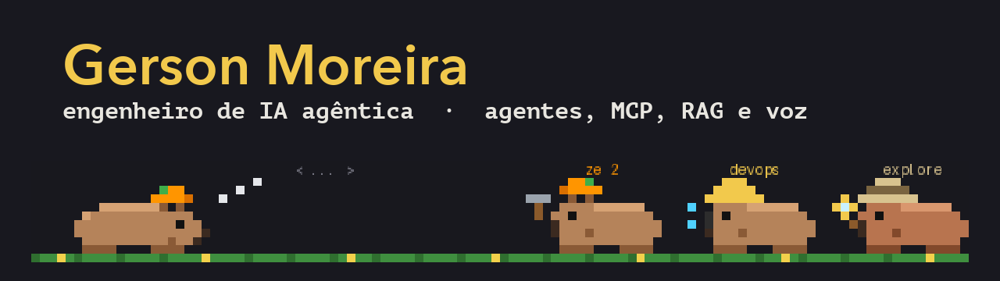

  

  
  

Sou engenheiro de IA agêntica em Belo Horizonte. Construo agentes que trabalham de verdade: times de agentes com ferramentas reais, servidores MCP, RAG, voz em tempo real e as peças de produto e plataforma em volta deles.

## O que eu faço

- **Agentes e times de agentes** com Agno e Claude Code: subagentes, skills, hooks e mods.
- **Servidores MCP** e um gateway de MCP que entrega ferramentas sob demanda aos agentes.
- **RAG híbrido** com busca vetorial, rerank e um juiz que confere se o trecho responde.
- **Voz em tempo real** com Gemini Live e OpenAI Realtime, com o servidor só repassando áudio e tratando as funções.
- **Produto full stack**: Next.js e TypeScript na frente, FastAPI e Python ou .NET atrás.
- **Plataforma**: AWS (EKS, ECR), Kubernetes, Helm, ArgoCD e GitOps.

## Em destaque

<table>
  <tr>
    <td width="50%" valign="top">
      <a href="https://github.com/headdira/ze-capibara"><strong>ze-capibara</strong></a> 
      Uma capivara em pixel art que trabalha acima do prompt do Claude Code. Cada subagente vira uma capivarinha com o traje dele. Vem com skills para criar bonecos, subagentes e skills. 
      TypeScript · Claude Code mod
    </td>
    <td width="50%" valign="top">
      <a href="https://github.com/headdira/tradutor"><strong>tradutor</strong></a> 
      Traduz um áudio em inglês para português: transcreve, traduz e gera o áudio de saída. 
      Python · fala e tradução
    </td>
  </tr>
</table>

## Stack

English

I'm an agentic AI engineer from Belo Horizonte, Brazil. I build AI agents that do real work: agent teams with real tools, MCP servers, RAG, real-time voice, and the product and platform pieces around them. Stack: Python, TypeScript, Next.js, FastAPI, .NET, Kubernetes, Argo CD and AWS.

